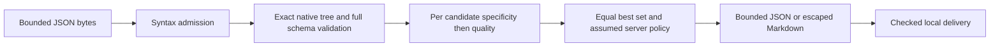

# HTTP media negotiation lab

An offline Python teaching model for declared media preferences. A more specific matching range determines a candidate's quality before candidates are compared. Quality zero excludes a candidate; equal best qualities remain a set. A separate, explicitly assumed server policy selects an offer or disregards preferences.

This lab evaluates invented normalized declarations, not raw Accept headers or actual HTTP responses. It supports a narrow declared `text/plain; format=fixed|flowed` subset and makes unsupported or ambiguous context explicit. See [CONTRACT.md](CONTRACT.md) for exact schemas, error precedence and bounds, and [SECURITY.md](SECURITY.md) for trust boundaries.

## Run

No runtime dependencies. Verified on Windows CPython 3.13.7; other platforms and versions have not been tested. From this directory:

```powershell
python -m medialab fixtures/cases.json
python -m medialab fixtures/cases.json --format markdown --output demo.md
python -m unittest discover -s tests -v
python -O -m unittest discover -s tests -v
```

Output files must be fresh; existing files and input aliases are rejected. The mixed fixture demo intentionally exits **2**, because 13 of its 40 cases are unsupported. Exit 0 means all cases are supported, including an assumed rejection with hypothetical status 406. Invalid input or failed delivery exits 1; argument errors exit 2. Help exits 0 only after successful delivery.

The reusable API is `medialab.parse(raw_bytes)` followed by `medialab.evaluate(native_document)`. `evaluate` independently validates native input; `parse` alone admits bounded JSON syntax, not the complete application schema. Results contain original declarations, governing range indices, exact integer thousandths, candidate matches, equal-best IDs and separately assumed server handling. They do not establish client capability or actual server behavior.

## Architecture



`contracts.py` owns admission and validation; `model.py` owns declared matching and policy; `report.py` owns serialization and fresh-file delivery; `__main__.py` owns CLI status and checked streams. No network, framework, model service or subprocess is used by the application.

## Evidence and limits

[VERIFICATION.md](VERIFICATION.md) links the passing 11-check receipt: 20 tests in normal and optimized Python, 40 full frozen expected reports, 64 independent finite controls, four detected semantic mutations with exact restoration, compilation and Bandit with zero findings/errors. Tests include actual closed-pipe processes and separately labeled closed Python streams and controlled failure seams. These synthetic checks are not HTTP conformance or production assurance.

[RESEARCH.md](RESEARCH.md) records source and license review of Werkzeug and WebOb and the decision to build a small standard-library model. No upstream implementation or test vectors were copied. CLI delivery builds on Jake's MIT byte-range lab. Original pre-code contract and fixture receipts are retained; [FREEZE-CORRECTION.md](research/FREEZE-CORRECTION.md) transparently records the later container-depth clarification. Fixture inputs and expected reports stayed byte-identical.

Unsupported scope includes raw header parsing, general parameters, implicit body defaults, representations/codecs, actual HTTP servers/browsers, networking and authentication. [DECISIONS.md](DECISIONS.md) and [LEARNING.md](LEARNING.md) explain the choices and lessons. MIT licensed. AI assistance: Codex implemented and self-reviewed the lab; local Ollama qwen3.5:2b supplied three bounded, source-checked research reminders. No independent review or real-model evaluation is claimed.

## Publication status

See [publication review](PUBLICATION.md) for the October 5 source snapshot, fresh local checks, evidence boundaries and current hosted-check distinction.
